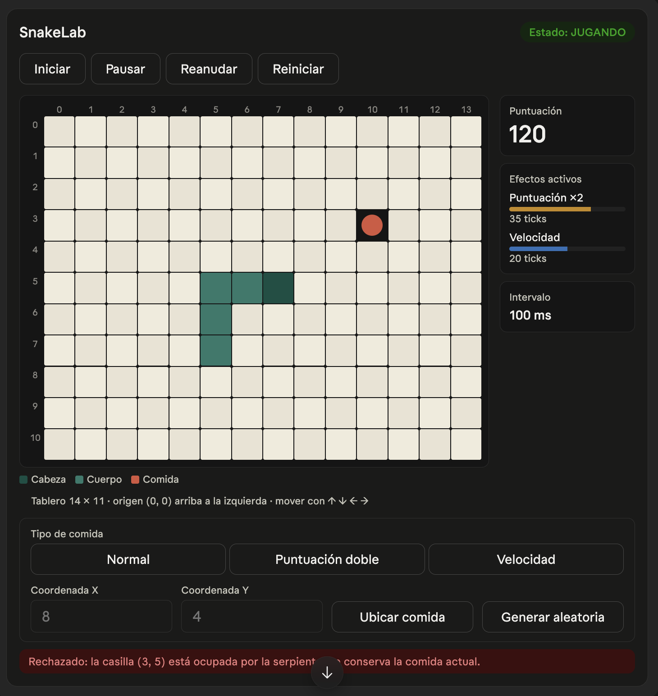
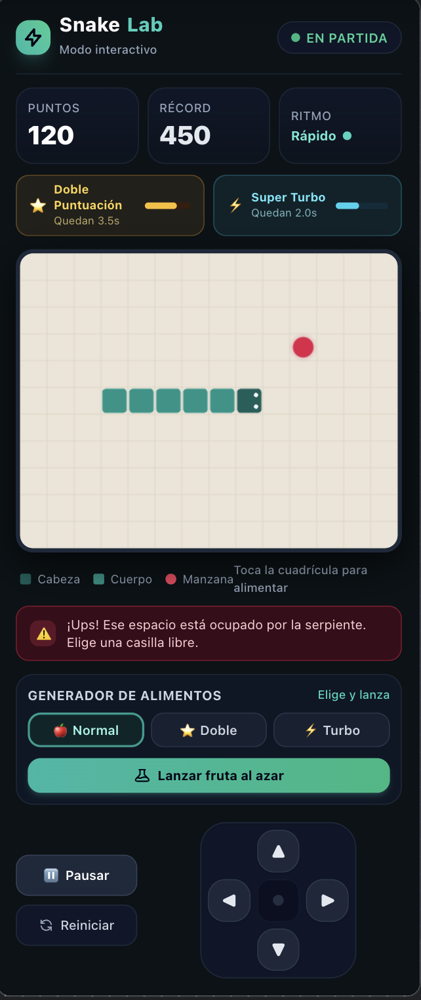
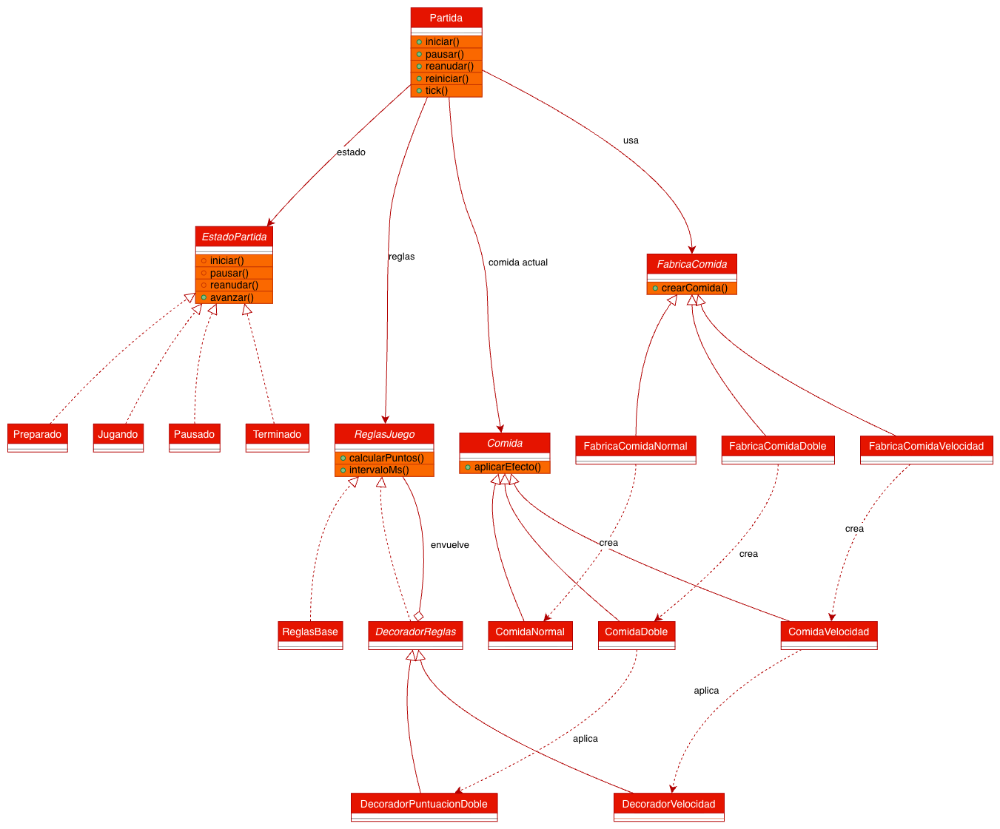

## Integrantes y usuario de github:
-Bryam Carchi[bryanstalin2031-lgtm]

-Andrea Sagbay[Andrea50]
## Mockup sencillo realizado con Claude

## Mockup mejorado con Stich

## Diagrama UML
El patron seleccionado para este proyecto es el Factory Method que nos va a ayudar a la creacion de los diferentes tipos de comida con sus respectivos efectos. Este patron nos ayuda a que La clase `Partida` solicite una comida a una fabrica especifica sin la necesidad de conocer la Clase concreta.
